# Chatter
Chatter is a full-stack, Discord-inspired chat application built as the centrepiece of my software development portfolio. The project was designed to explore real-world full-stack concepts including authentication, REST APIs, relational database design, and real-time communication using WebSockets.

Overview
This is my first full-stack application, a watered-down, Discord-like chat service. Where users can connect to friends, and can send messages in real-time.

Rather than following a tutorial, I designed and built this application independently to gain practical experience across both frontend and backend development. The project challenged me to solve problems involving authentication, database relationships, API design, real-time communication, and application architecture while writing clean, maintainable code.

Tech Stack
Frontend:
 - React.js
 - SCSS
 - Axios

Backend:
 - Node.js + Express
 - JSON Web Tokens (JWT)
 - Socket.io
 - MySQL

Features
- User registration and login
- JWT authentication with rotating refresh tokens
- Secure password hashing
- Friend request system inspired by Discord
- Real-time messaging using Socket.IO
- Persistent chat history stored in MySQL
- RESTful API for client/server communication
- Responsive interface
- MVC architecture

Screenshots

1. 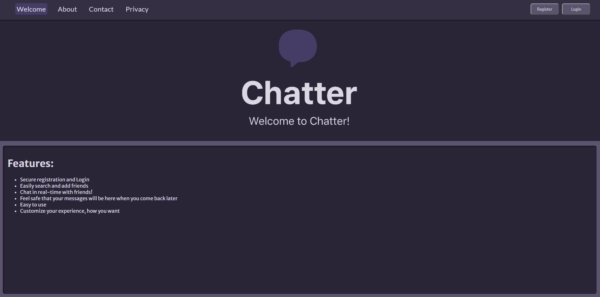

2. 

3. 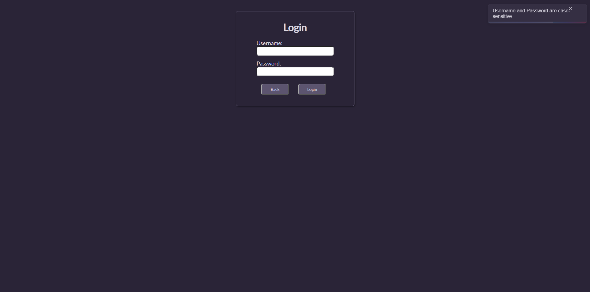

4. 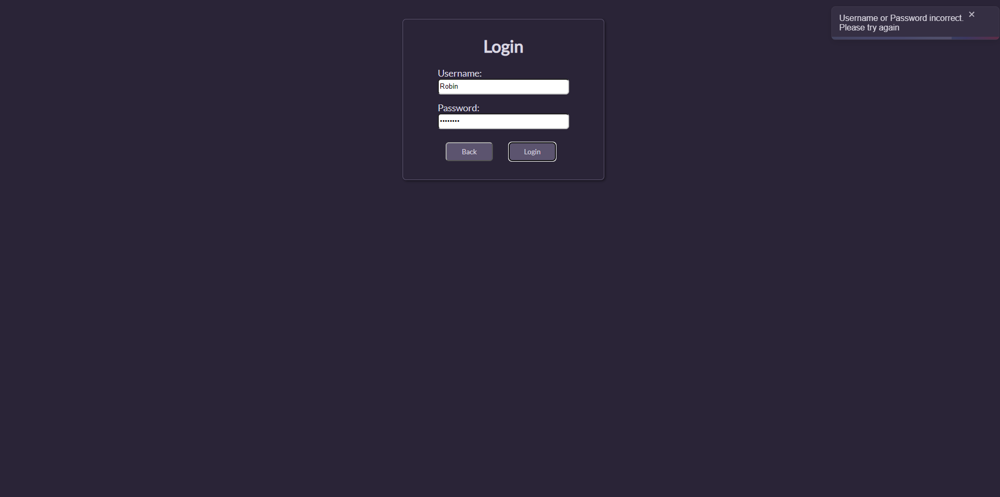

5. 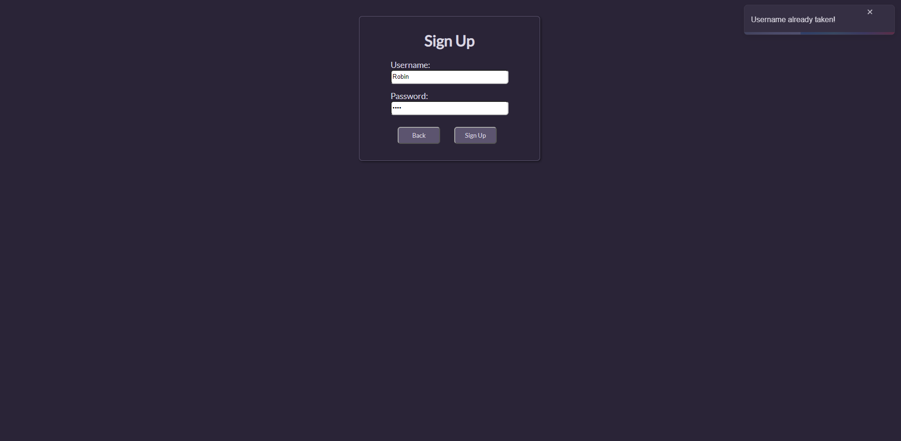

6. 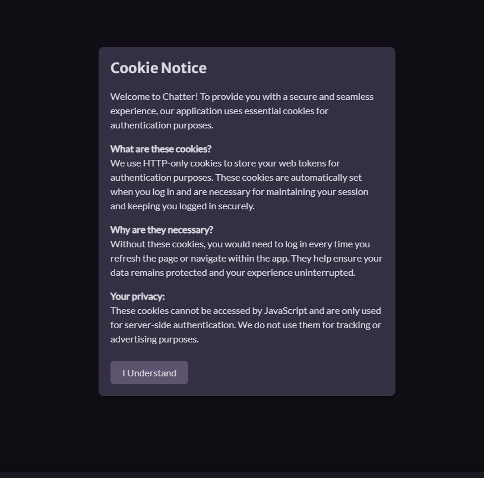

7. 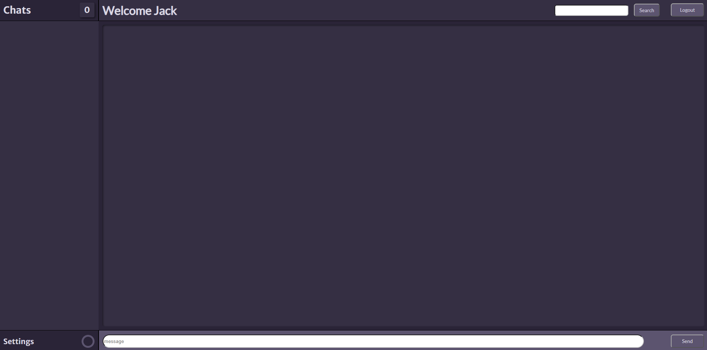

8. 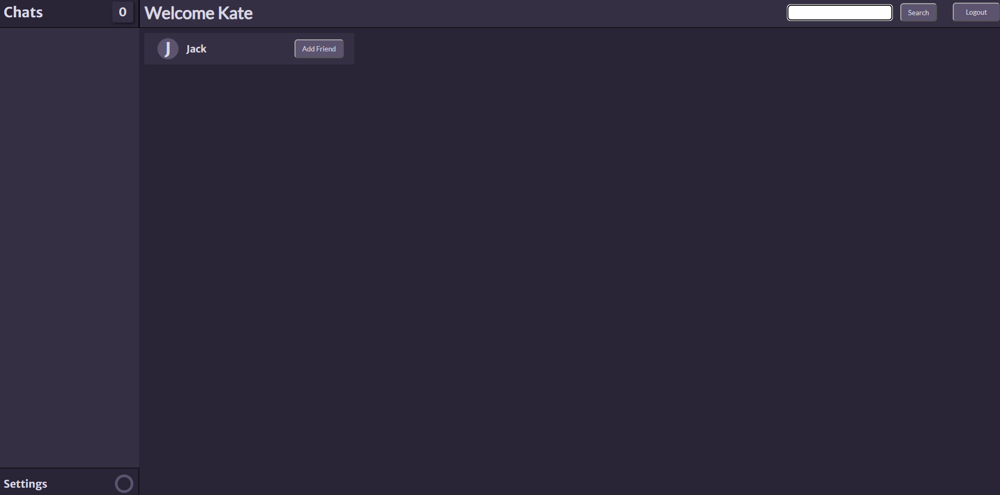

9. 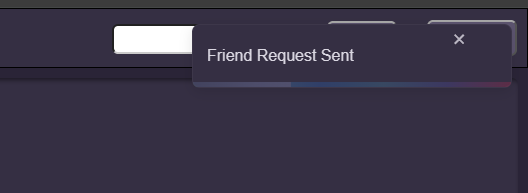

10. 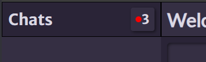

11. 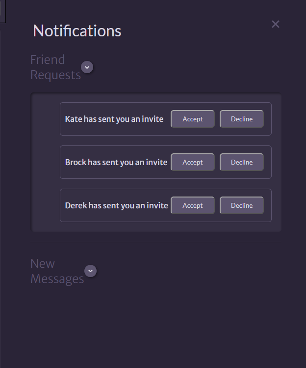

12. 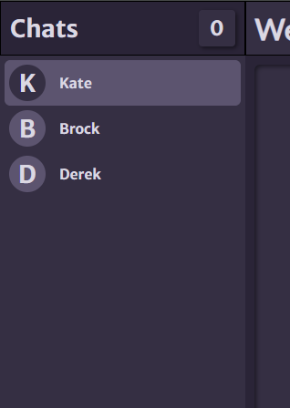

13. 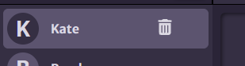

14. 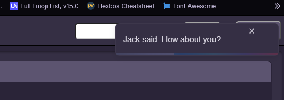

15. 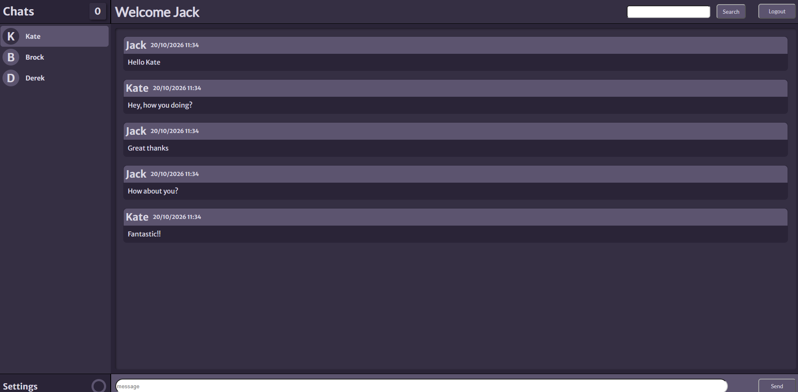

16. 

17. 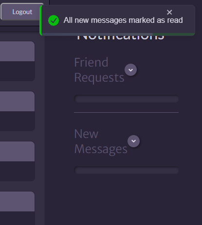

What I Learned

This project significantly improved my understanding of:

- REST API design
- Authentication and authorisation
- JWT access and refresh token flows
- Database design and SQL queries
- Real-time communication using Socket.IO
- State management in React
- Backend architecture using Express and MVC
- Debugging complex frontend/backend interactions

Challenges

Some of the biggest challenges during development included:

- Designing a secure authentication flow using access and refresh tokens
- Synchronising real-time Socket.IO events with persisted database messages
- Structuring the project using the MVC pattern
- Creating efficient SQL queries for conversations and friendships

## Installation

### 1. Clone the repository

```bash
git clone https://github.com/JLampProf/Chatter.git
cd Chatter
```

### 2. Install dependencies

Install the frontend dependencies:

```bash
cd client
npm install
```

Install the backend dependencies:

```bash
cd ../server
npm install
```

### 3. Configure environment variables

#### Backend (`server/.env`)

Create a `.env` file inside the `server` directory.

Example:

```env
PORT=5000

DB_HOST=localhost
DB_USER=your_username
DB_PASSWORD=your_password
DB_NAME=chatter

AUTH_TOKEN_SECRET=your_access_secret
REFRESH_TOKEN_SECRET=your_refresh_secret
```

#### Frontend (`client/.env`)

Create a `.env` file inside the `client` directory.

Example:

```env
VITE_BACK_URL=http://localhost:5000
```

The frontend uses `VITE_BACK_URL` to communicate with the Express backend. If you deploy the backend elsewhere, simply update this value to point to the deployed API.

### 4. Start the backend server

```bash
cd server
npm run dev
```

### 5. Start the frontend

Open a second terminal and run:

```bash
cd client
npm run dev
```

### 6. Open the application

Frontend:
```
http://localhost:5173
```

Backend:
```
http://localhost:5000
```

Project Structure

/client
  /public
  /src
    /components
    /context
    /data
    /pages
    /scripts
    main.jsx
  (.env goes here)

/server
  /config
  /controllers
  /model
  /routes
    /api
  (.env goes here)
  server.js
